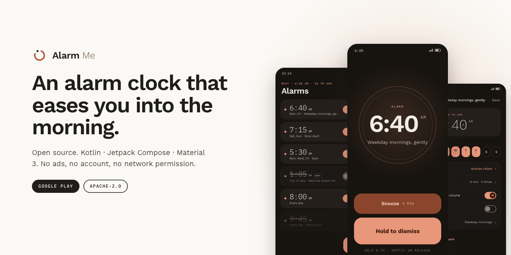

  

# Alarm Me

A clean, no-nonsense alarm clock for Android.

## Features

- **Flexible scheduling** — repeat on chosen days of the week, or set one-off alarms on specific
  dates.
- **Custom ringtones** — pick a different ringtone per alarm.
- **Snooze your way** — configure how long a snooze lasts and how many times you can hit it.
- **Gradual volume** — let the alarm ease in instead of blasting at full volume immediately.
- **Vibration control** — turn vibration on or off per alarm.
- **App-wide preferences** — 12/24-hour time format, light/dark theme, what the volume buttons do
  while an alarm is ringing, and how long an unattended alarm keeps ringing before it times out.

## Get the app

<!-- TODO: replace with the real Google Play listing once published -->
[Get it on Google Play](<PLAY_STORE_URL>) *(coming soon)*

Not on Google Play yet? You can build Alarm Me from source — see
[CONTRIBUTING.md](CONTRIBUTING.md) for the steps.

## Requirements

Android 7.0 (API 24) or newer.

## License

Alarm Me is licensed under the [Apache License 2.0](LICENSE).

## Contributing

Contributions are welcome — see [CONTRIBUTING.md](CONTRIBUTING.md) for how to build the project
and the conventions the codebase follows.
